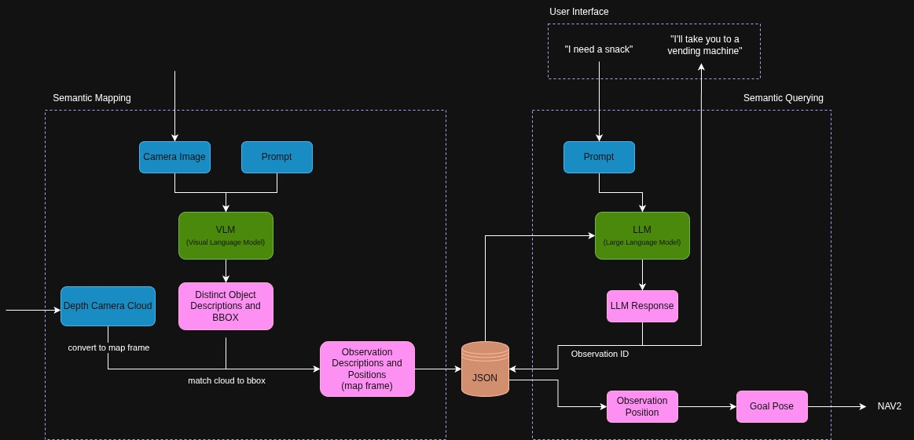

# AI Guide Robot
AI Guide Robot can help users navigate any environement.

AI Guide Robot makes use of a VLM to identify distict objects in any environment. A camera on the mobile robot feeds th VLM images to reason over, and the positions of these objects get stored in a database.

A user can then ask the robot what they are looking for, and the robot will infer, using an LLM, the most relavent object it found in the environment and will guide the user to the objects position.

## System Diagram



## Mobile Robot


The mobile robot uses:
- [slam_toolbox](https://github.com/SteveMacenski/slam_toolbox) + 2D-LiDAR for SLAM 
- [Nav2](https://docs.nav2.org/rolling/) for autonomous navigation
- 2D-LiDAR + depth camera for obstacle detection


## Setup

This project was built on [ROS 2 Jazzy](https://docs.ros.org/en/jazzy/Installation.html) and [Ubuntu 24.04](https://ubuntu.com/blog/tag/ubuntu-24-04-lts) and simulated on [Gazebo Harmonic](https://gazebosim.org/docs/harmonic/install_ubuntu/).

Build tools:
```bash
sudo apt update
sudo apt install python3-colcon-common-extensions python3-rosdep
```

Clone the repo and install ROS dependencies:

```bash
git clone https://github.com/Sach-P/ai-guide-robot.git
cd ai-guide-robot

source /opt/ros/jazzy/setup.bash
rosdep update
rosdep install --from-paths src --ignore-src --rosdistro jazzy -y
```

Install Python dependecies:

```bash
pip install -r requirements.txt
```
Build the project:
```bash
colcon build
source install/setup.bash
```
Install Ollama and download the LLM:
```bash
curl -fsSL https://ollama.com/install.sh | sh
ollama pull qwen2.5:3b-instruct
```
You may change the VLM and LLM based on your hardware constraints.

## Usage
Full robot bringup with NAV2 and slam_toolbox stack + Gazebo environment
```bash
ros2 launch robot_bringup auto_nav.launch.py
```

Running the semantic mapper to build object database:
```bash
ros2 run semantic_mapping semantic_mapper
```

Running the semantic querier to find object positions based on a givn prompt:
```bash
ros2 run semantic_querying semantic_querier
```

Running teleoperated control (useful for the mapping portion)
```bash
python3 src/scripts/keyboard_teleop_pynput.py
```
## Demo

## Future Work
### Sim-to-real transfer
Currently the project is in simulation, but a real world robot will be built.
### Object segmentation model
To get the objects position from the bounding box provided by the VLM, the depth camera’s point cloud is matched to the bounding box and the median is calculated.

But this can cause issues when the median lands on a point behind the object of interest. A segmentation model is the more accurate approach but requires better hardware.
